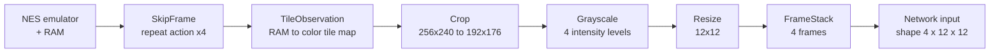

# Mario RL

A reinforcement-learning agent that learns to play **Super Mario Bros.** from scratch, built with PyTorch and a **Double DQN**, along with an interface for training, resuming, and evaluating it.

## Highlights

- **Semantic observations:** the environment reads the console's RAM and redraws the scene as a 12×12 grid, which keeps the network small and training fast.
- **Double DQN:** with a target network, a replay buffer backed by TorchRL, Huber loss, gradient clipping, and per-episode learning-rate and epsilon decay.
- **Interface:**, a PySide6 desktop interface with live charts, checkpoint browsing, resume/transfer learning, and an option to select any of the 32 levels.
- **Evaluation:** Test runs can be recorded as video with an overlay showing the agent's observation, hidden-layer activations, and the buttons it presses.

## How it works

### Observation pipeline




| Element | Meaning |
|---|---|
| Empty | background |
| Solid | ground and bricks |
| Pipe | pipes |
| Enemy | active enemy slots |
| Mario | Mario's position |

 Each type of element is rendered as a tile: the background is white, blocks and pipes are light gray, enemies are dark gray and Mario is black. The agent chooses between two actions: **sprint right** and **sprint-jump right**.

### Network

`MarioNet` keeps an online and a target copy of the same CNN. The target copy is frozen and synced periodically.

```
input (4×12×12)
  -> Conv 3×3, 32  → ReLU
  -> Conv 3×3, 64  → ReLU
  -> Conv 3×3, 64  → ReLU → Flatten
  -> Linear 256    → ReLU
  -> Linear (n actions)
```

### Agent defaults

| Setting | Default |
|---|---|
| Algorithm | Double DQN (online network picks the action, target network scores it) |
| Discount (γ) | 0.95 |
| Optimizer | Adam, LR 2.5e-4, decayed ×0.9991 per episode down to 1e-5 |
| Exploration (ε) | 1.0 → 0.1, ×0.9993 per episode |
| Replay buffer | 75,000 transitions |
| Batch size | 64 |
| Learn every | 3 steps (after a 10,000-step burn-in) |
| Target sync | every 10,000 steps |
| Loss | Huber, gradient norm clipped to 1.0 |
| Reward scaling | ÷10 per step (÷100 for large rewards such as the flag) |

All of these can be changed from the app's **Additional settings** panel.

## Interface

Launch the app with `python main.py`.

**Train tab**
- Pick any level from World 1-1 to 8-4
- Set the number of episodes, checkpoint and log intervals, warm-up, seed, and device
- Start a new run, **resume** a previous one (full training state), or **transfer** weights into a new run
- Tune the agent in the collapsible **Additional settings** panel

**Test tab**
- Choose a checkpoint, level, and number of runs
- Set the test epsilon and a max-steps cap so stuck runs end
- Optionally record the best run as an MP4, with or without the neural-network overlay

**Dashboard**
- Live stat cards, progress bar with ETA, reward and flag-rate charts, and a console
- **Stop** button that saves state before exiting (click again to force-kill)
- Dark and light themes

## Project structure

```
.
├── main.py                 # Graphical interface + training/testing workers
├── agents/
│   └── mario.py            # Double DQN agent: act, cache, recall, learn
├── models/
│   └── mario_nn.py         # MarioNet (online + target CNNs)
├── environments/
│   └── wrappers.py         # SkipFrame, TileObservation, Crop, Grayscale, Resize
├── metrics/
│   └── logger.py           # training metrics and plots
├── output/                 # training runs and checkpoints (created automatically)
└── runs/                   # evaluation results and videos (created automatically)
```
